<p align="center">
  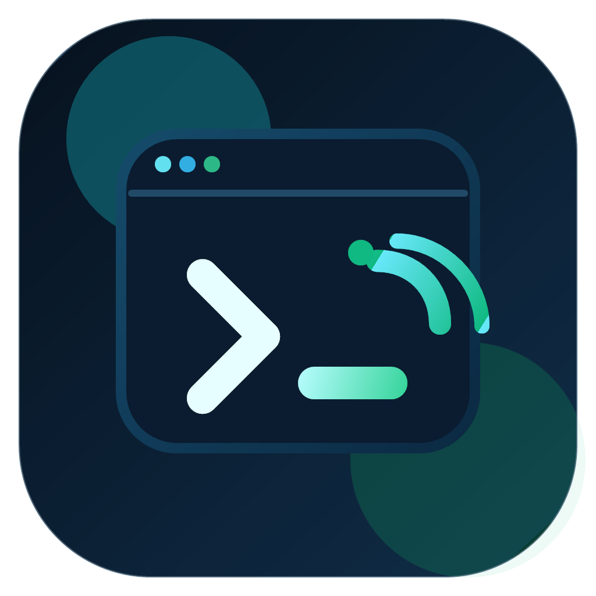
</p>

<h1 align="center">Remote Terminal</h1>

<p align="center">
  <strong>Your PC terminal in your pocket.</strong><br />
  Pair with a QR code, run PowerShell or CMD, browse files, manage tasks, programs and services, sync clipboard text, and stay connected — securely.
</p>

<p align="center">
  <a href="#-downloads">Downloads</a> •
  <a href="#-first-time-setup">First-time setup</a> •
  <a href="#-quick-start">Quick Start</a> •
  <a href="#-features">Features</a> •
  <a href="#-screenshots">Screenshots</a> •
  <a href="#-how-it-works">How it works</a> •
  <a href="#-faq">FAQ</a>
</p>

<p align="center">
  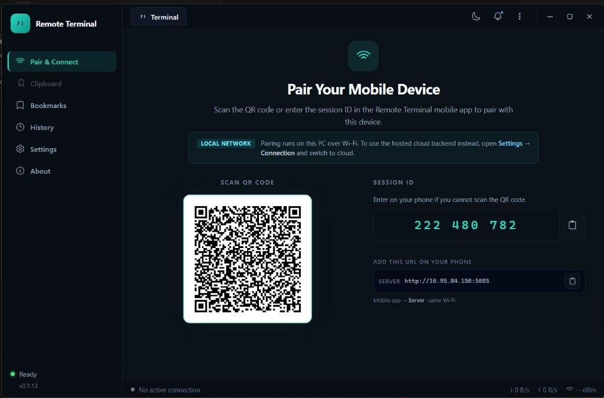
</p>

---

## 🎯 Purpose

**Remote Terminal** lets you control a real shell on your Windows or Mac computer from your **Android or iOS** phone.

Use it when you are away from your desk but still need to:

- Run **PowerShell** or **CMD** on a Windows PC (pick either from the session hub)
- Use **bash/zsh** on macOS
- **Upload and download files** without SFTP
- See what is running and **End** a stuck task with the **Task Manager**
- **Start, stop and restart services** (Windows services, systemd units, macOS launchd jobs)
- **Launch and close installed programs** on the PC
- **Sync clipboard text** between phone and PC (each side opt-in)
- Keep a **persistent session** when you switch apps on your phone

The desktop app runs in the **system tray**, shows a **QR code** for pairing, and relays terminal I/O through a secure backend. The mobile app is optimized for touch, small screens, scroll controls, and intermittent networks.

> **Note:** This repository is the **public distribution & documentation** hub. Application source code is maintained separately.

---

## 📥 Downloads

### Windows 10/11 (x64)

| Format | Download | Notes |
|--------|----------|--------|
| **Portable** (zip) | [RemoteTerminal-Portable-x64.zip](https://github.com/w3sourcecode/remote-terminal-app/releases/latest/download/RemoteTerminal-Portable-x64.zip) | Unzip and run `Remote Terminal.exe` — no installer |
| **Setup** (NSIS) | [RemoteTerminal-Setup-x64.exe](https://github.com/w3sourcecode/remote-terminal-app/releases/latest/download/RemoteTerminal-Setup-x64.exe) | Guided installer; choose install folder |

### macOS 11+

| Mac | Download | Notes |
|-----|----------|--------|
| **Apple Silicon** (M1/M2/M3/M4) | [RemoteTerminal-macOS-arm64.dmg](https://github.com/w3sourcecode/remote-terminal-app/releases/latest/download/RemoteTerminal-macOS-arm64.dmg) | Open DMG → drag to Applications |
| **Intel** | [RemoteTerminal-macOS-x64.dmg](https://github.com/w3sourcecode/remote-terminal-app/releases/latest/download/RemoteTerminal-macOS-x64.dmg) | For Intel Macs |

First launch on unsigned Mac builds: right-click **Remote Terminal** → **Open**, or allow in **System Settings → Privacy & Security**.

### Mobile

| Platform | Download | Notes |
|----------|----------|--------|
| **Android** | [Google Play](https://play.google.com/store/apps/details?id=com.billten.remoteterminal) | Requires the desktop agent on your PC |
| **iOS** | [App Store — Remote Terminal Pro](https://apps.apple.com/pk/app/remote-terminal-pro/id6771671841) | Requires the desktop agent on your PC |
| **Web** | [In Browser ](https://remote-terminal.github.io/) | Requires the desktop agent on your PC |

## 🆕 First-time setup

Use this order the first time you install Remote Terminal.

### Step 1 — Desktop agent (your PC)

1. **Download** a [Windows package](#-downloads) (portable zip or setup exe) or a **macOS DMG** (Apple Silicon or Intel).
2. **Windows:** run the **setup exe** or unzip the portable zip and run **`Remote Terminal.exe`**. **Mac:** open the DMG and drag **Remote Terminal** to Applications.
3. On first launch, set a **join password** when prompted (recommended — required for Session ID pairing).
4. The app stays in the **system tray**. Open the dashboard → **Pair & Connect**:
   - **QR code** on the left (scan from your phone)
   - **Session ID** on the right, formatted like `123 456 789`
   - **Local network URL** when using same-Wi-Fi mode (phone → Server in mobile settings)

Keep the desktop agent running while you use the phone.

### Step 2 — Mobile app (your phone)

1. Install **[Remote Terminal on Google Play](https://play.google.com/store/apps/details?id=com.billten.remoteterminal)** (Android) or **[Remote Terminal Pro on the App Store](https://apps.apple.com/pk/app/remote-terminal-pro/id6771671841)** (iOS).
2. On first open, the app shows a **setup tour** — follow it to download the desktop agent and learn how to pair.
3. Tap **Scan QR** and point the camera at the PC screen (fastest), **or** tap **Session ID**, enter the nine digits, then the **join password** from desktop Settings.
4. After pairing, open **CMD**, **PowerShell**, **Files**, **Programs**, **Task Manager**, **Services** or **Clipboard** from the session hub.

Tap **Setup** on the mobile home screen anytime to replay the tour.

### Step 3 — Stay connected

- The phone **restores your session** when you reopen the app (saved sessions on Home).
- The desktop agent keeps running in the tray until you quit.
- On Android home, press **back twice** to exit the app.
- After PC sleep/hibernate, use **Reconnect now** on the desktop dashboard if the agent shows offline.

---

## ⚡ Quick Start

### 1. Desktop (host PC)

1. Download a **Windows** portable zip or setup exe (or install the **macOS** app from a DMG).
2. Run **Remote Terminal** — on first launch, set a **join password** (recommended for pairing).
3. The tray icon appears; open the **dashboard** → **Pair & Connect** to see the **QR code** and formatted **session ID** side by side.

**Connection mode** (Settings → Connection):

| Mode | Best for |
|------|----------|
| **Cloud** | Phone and PC anywhere with internet; uses the hosted HTTPS backend |
| **Local network** | Same Wi-Fi — pairing on your LAN without cloud; mobile app uses the PC’s LAN URL |

### 2. Mobile (phone)

1. Install from [Google Play](https://play.google.com/store/apps/details?id=com.billten.remoteterminal) (Android) or the [App Store](https://apps.apple.com/pk/app/remote-terminal-pro/id6771671841) (iOS).
2. Scan the QR (encodes server + session) **or** enter session ID + join password.
3. Open the **session hub** — choose **CMD**, **PowerShell**, **Files**, **Programs**, **Task Manager**, **Services** or **Clipboard**.

<p align="center">
  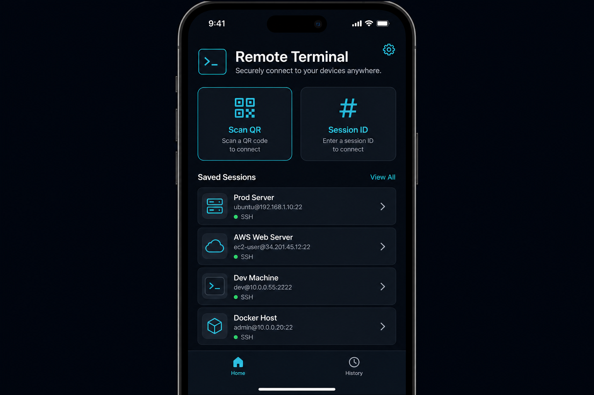
  &nbsp;&nbsp;
  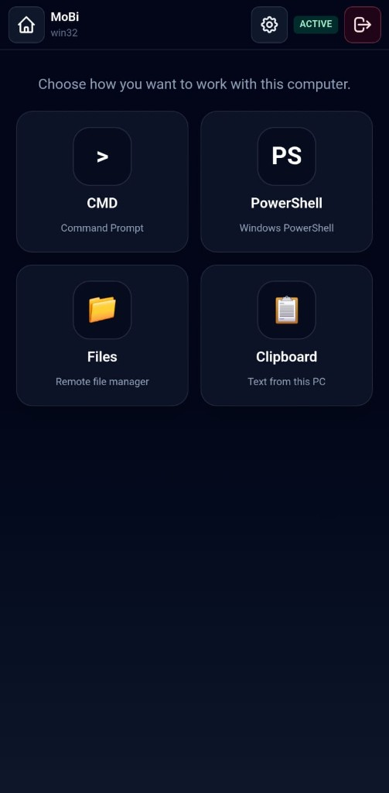
  &nbsp;&nbsp;
  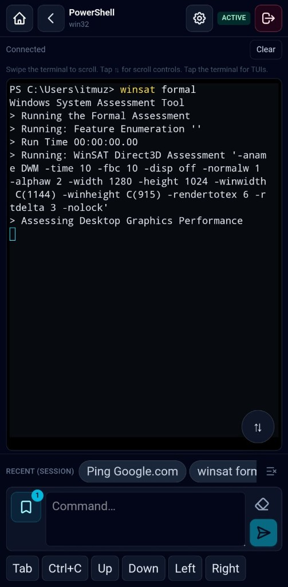
</p>

### 3. Stay connected

- The mobile app **restores your session** when reopened.
- The desktop agent keeps running in the tray until you quit.
- Use **double back** on Android home to exit the app.

---

## ✨ Features

| Feature | Description |
|---------|-------------|
| 🖥️ **Remote shell** | Real PTY on the desktop — **CMD** and **PowerShell** on Windows; bash/zsh on macOS |
| 📱 **QR pairing** | Scan from the phone; optional pairing token when join password is set |
| 🏠 **Local network mode** | Pair on the same Wi-Fi using the PC’s LAN URL — no cloud required |
| ☁️ **Cloud mode** | Hosted backend for pairing when phone and PC are not on the same network |
| 🔐 **Join password** | Protects session ID pairing; asked once per PC until you tap **Leave** on mobile |
| 🔒 **Optional quit password** | Extra protection when closing the agent from the tray |
| 📁 **Remote files** | Browse drives and folders; upload, download, and delete on the connected PC |
| 📋 **Clipboard sync** | Phone → PC and PC → phone (each side opt-in in session settings / desktop settings) |
| 🔄 **Session restore** | Mobile reconnects from Home; desktop survives app backgrounding |
| 📊 **Activity log** | Desktop records connects, commands, and file operations locally |
| 🪟 **Windows & macOS agent** | Tray app with dashboard, bookmarks, clipboard history, settings |
| 🤖 **Android & iOS client** | Terminal UI, files, clipboard screen, session settings |
| 📜 **Terminal UX** | Per-shell history on Windows, on-demand scroll controls, shortcut keys (Tab, Ctrl+C, arrows) |
| ✂️ **Select, copy & paste** | Long-press a word, drag the handles, then **Copy**, **All**, **Paste** or **Done**; multi-line pastes show a preview first |
| 🎨 **19 terminal themes** | Restyle the whole terminal screen — Dracula, One Dark, Monokai, Nord, Tokyo Night, Catppuccin, Gruvbox, Solarized, GitHub and terminal-app looks such as Windows Terminal, PowerShell, Ubuntu and macOS Terminal. Eight offline monospace fonts included |
| 📊 **Task Manager** | Live CPU and memory, searchable and sortable task list grouped by program. **End** asks a program to close, like closing its window. Protected system tasks are refused by the agent |
| 🧩 **Services** | List, search and filter services; **Start**, **Stop** or **Restart** them. Stop and Restart ask first, critical services are locked by the agent, and one slow service never blocks the others. Can be switched off in the desktop settings |
| 🚀 **Programs** | Browse installed programs and launch or close them from the phone |
| 🐧 **Linux agent (headless)** | Run the agent on a Linux server or VPS with bash, controlled with `remote-terminal config`, and install it as a systemd service so it restarts after a reboot or crash |
| ⬆️ **Updates** | Windows installs update from **About → Check for updates**, with progress shown in place |
| ⚡ **HTTP file channel** | Large transfers use a dedicated HTTP path alongside SignalR |
| 🛡️ **HTTPS backend** | Session tokens and hub traffic over TLS in production |

---

## 📸 Screenshots

### Desktop agent

<p align="center">
  
</p>

<p align="center">
  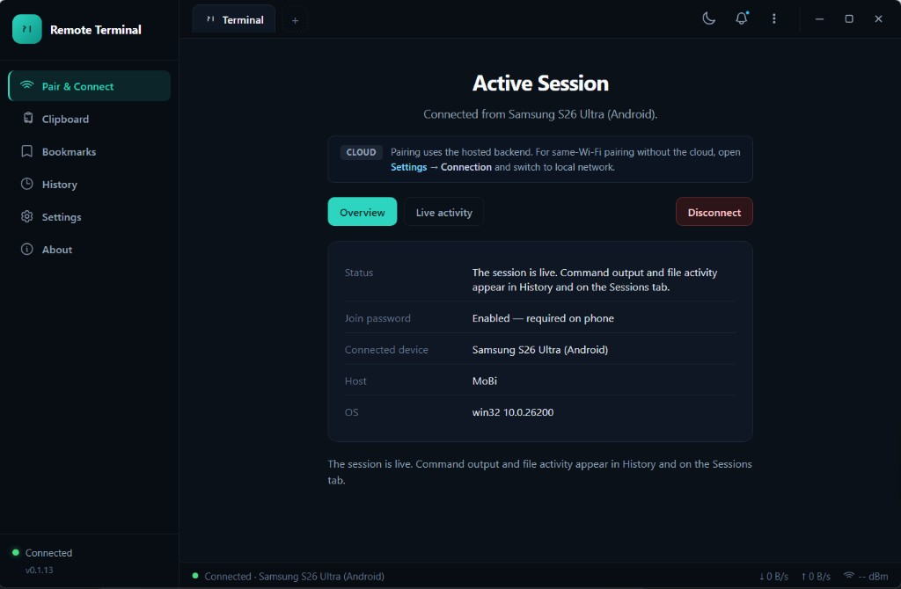
</p>

| Area | What you see |
|------|----------------|
| **Pair & Connect** | QR code, 9-digit session ID, cloud vs local network banner |
| **Active session** | Connected phone, host/OS, join password status, disconnect |
| **Clipboard** | History of text received from the phone; toggle **Share PC clipboard with phone** |
| **Activity** | Local log of commands, file ops, and connections |

### Mobile app

<p align="center">
  
  &nbsp;&nbsp;
  
  &nbsp;&nbsp;
  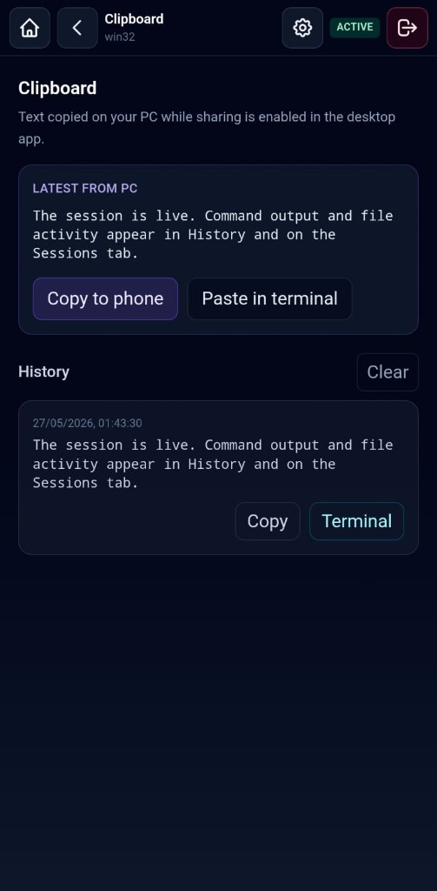
</p>

<p align="center">
  
  &nbsp;&nbsp;
  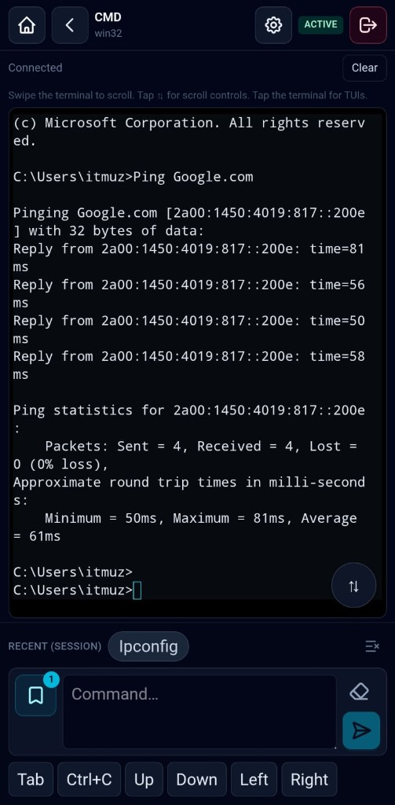
  &nbsp;&nbsp;
  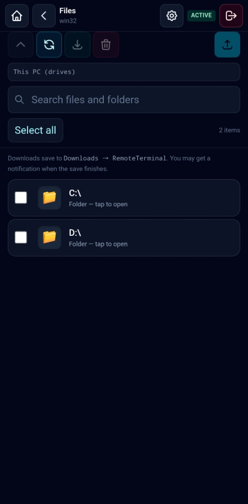
</p>
<p align="center">
  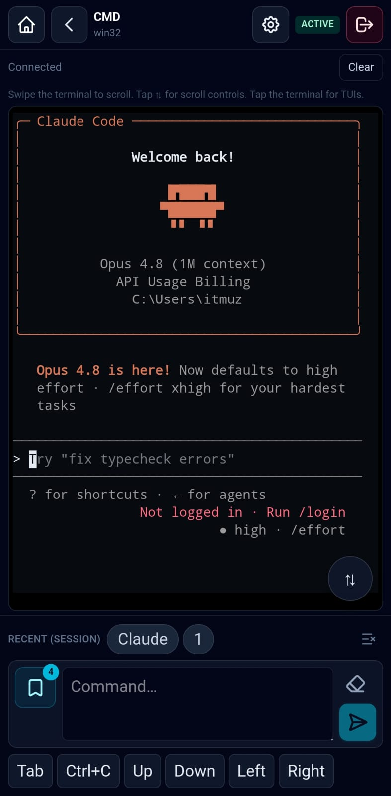
  &nbsp;&nbsp;
  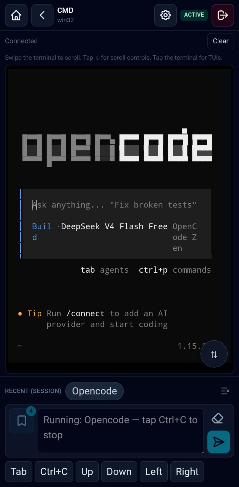
</p>

---

## 🏗️ How it works

```text
┌─────────────┐     QR / Session ID      ┌─────────────┐
│   Mobile    │ ◄──────────────────────► │   Backend   │
│             │  websocket + JWT + HTTP  │             │
└──────┬──────┘                          └──────┬──────┘
       │                                          │
       │    terminal / files / clipboard          │
       └──────────────────┬───────────────────────┘
                          │
                   ┌──────▼──────┐
                   │   Desktop   │
                   │    agent    │
                   └─────────────┘
```

1. The **desktop agent** registers a session and displays a QR code (and pairing token when a join password is set).
2. The **mobile app** scans the QR (or enters session ID + join password).
3. The **API** issues a session token; both sides connect to **SignalR** hubs (terminal, files, clipboard, programs, task manager, services). Each feature has its own connection, so a slow service list never stalls your terminal.
4. Terminal keystrokes and output are relayed to a local **PTY** on the PC.
5. File bytes use **HTTP** endpoints for throughput; control messages stay on the hub.

---

## 📖 Detailed usage

### Desktop agent

| Action | How |
|--------|-----|
| Open dashboard | Tray icon → **Show QR** / menu **Open dashboard** |
| Settings | Tray → **Settings** — join password, quit password, connection mode (cloud / local), auto-start |
| Reconnect after sleep | Dashboard → **Reconnect now** if status shows offline |
| Check for updates | Windows: **About → Check for updates** |
| Allow service control | Settings → turn **Allow service control from phone** on or off |
| Disconnect phones | Dashboard or tray → disconnect session |
| View activity | Dashboard → **Activity** (local history) |
| Clipboard | Dashboard → **Clipboard** — phone → PC history; enable PC → phone sharing in settings |

### Mobile app

| Screen | What you can do |
|--------|-----------------|
| **Home** | Scan QR, enter session ID, open saved sessions (online / closed) |
| **Session hub** | **CMD**, **PowerShell**, **Files**, **Programs**, **Task Manager**, **Services**, **Clipboard**; gear opens session settings |
| **Terminal** | Run commands; recent commands; scroll controls; Tab / Ctrl+C / arrow keys; select, copy and paste; theme picker |
| **Files** | Browse remote folders; upload & download to device Downloads |
| **Programs** | Browse installed programs; launch or close them on the PC |
| **Task Manager** | Live CPU and memory, search and sort tasks, **End** a task (turn on **Live** for continuous updates) |
| **Services** | Search, filter and sort services; **Start**, **Stop**, **Restart** with confirmation; locked rows are critical services |
| **Clipboard** | Latest from PC; **Copy to phone** or **Paste in terminal**; history |
| **Session settings** | Share/receive clipboard, auto-sync to phone, default Windows shell |

### Pairing without QR

1. On desktop, note the **9-digit session ID** (shown as `123 456 789`) on **Pair & Connect**.
2. On mobile: **Session ID** → enter ID → **join password** from desktop Settings.
3. Tap **Connect**.

---

## 📊 Comparison

| Capability | Remote Terminal | SSH + Termius |
|------------|-----------------|---------------|
| Real terminal (PTY) | ✅ | ✅ |
| Mobile-first UI | ✅ | ✅ |
| QR / simple pairing | ✅ | ❌ |
| Same-Wi-Fi local mode | ✅ | LAN only |
| Remote file browser | ✅ | SFTP only |
| Clipboard sync | ✅ | ❌ |
| Task manager and service control | ✅ | ❌ |
| Join password gate | ✅ | Keys/password |
| Lightweight tray agent | ✅ | N/A |
| No router port forward* | ✅ | ❌ |

\*Cloud mode uses an outbound connection to your API. Local network mode uses the PC’s LAN address on the same Wi-Fi.

---

## ❓ FAQ

**Is the source code public?**  
This repo is for **downloads and documentation**. Source is in a private development repository.

**Do I need to open firewall ports on my PC?**  
**Cloud mode:** the desktop agent connects **outbound** to your API — you do not expose your PC to the internet. **Local network mode:** the bundled API listens on your LAN (same Wi-Fi); allow it in Windows Firewall if prompted.

**Why is a join password recommended?**  
So random devices cannot attach to your session if they guess the session ID.

**Can I use PowerShell and cmd on Windows?**  
Yes — pick **CMD** or **PowerShell** from the session hub, or set a default in **Session settings**.

**Is it safe to stop services and end tasks from my phone?**  
The desktop agent enforces the rules itself, not just the app: critical services and protected system tasks are refused, Stop and Restart ask for confirmation, and tasks owned by other users need the agent to run as administrator. Service control can be turned off in the agent's settings.

**Does it run on Linux?**  
Yes, as a headless agent for servers and VPSes (bash, `remote-terminal config`, optional systemd service). The public downloads on this page cover Windows and macOS.

**How does clipboard sync work?**  
Enable **Share with desktop** on the phone and **Share PC clipboard with phone** on the desktop. PC → phone copies appear in the mobile **Clipboard** screen; use **Copy to phone** or **Paste in terminal**.

**Where is the Android app?**  
[Google Play — Remote Terminal](https://play.google.com/store/apps/details?id=com.billten.remoteterminal)

**Where is the iOS app?**  
[App Store — Remote Terminal Pro](https://apps.apple.com/pk/app/remote-terminal-pro/id6771671841)

**Where is macOS download?**  
Use the **Apple Silicon** or **Intel DMG** links above. Builds are produced on GitHub Actions; see [releases/BUILD_MACOS.md](releases/BUILD_MACOS.md) if you need to rebuild.

---

## 📄 License

Documentation and release assets in this repository are provided for distribution of the **Remote Terminal** application.

Application licensing is defined by the publisher. Contact the maintainer for commercial or redistribution terms.

---

## ⭐ Support

If Remote Terminal helps your workflow, **star this repo** and share feedback via [GitHub Issues](https://github.com/w3sourcecode/remote-terminal-app/issues).

---

<p align="center">
  Built for developers who need their terminal within reach — desk, couch, or coffee shop.
</p>
